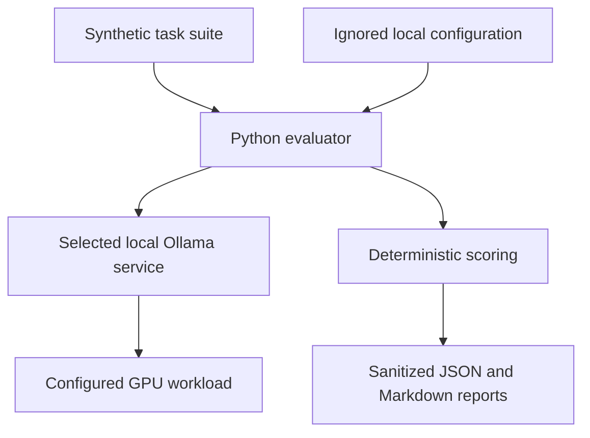

# Local LLM Evaluation — Seven-GPU AI Lab

Repeatable, task-based evaluation for JT Corbin's Ubuntu inference server: **5 × Tesla P100 16 GB, RTX 3090 24 GB, and RTX 3060 12 GB**. The lab has 116 GB of VRAM distributed across seven devices, not a shared memory pool.

This project connects local Ollama services to synthetic tests for exact instruction following, structured output, reasoning, information extraction, and security-log triage. It compares task correctness alongside generation speed and request latency, rather than treating faster output as better output.

**Status:** New evaluation tooling authored for the existing lab. Server offline for maintenance at creation; no live scores or speed claims are included. Offline tests validate the harness, not the models or GPU execution.

## Server-specific design

| Profile | Hardware | Recorded role | Current evidence |
|---|---|---|---|
| `general-3090` | RTX 3090 · 24 GB | General assistant / larger local models | Historical role; reverify service mapping |
| `automation-3060` | RTX 3060 · 12 GB | Security assistant / automation inference | Historical role; reverify service mapping |
| `p100-research` | P100 · 16 GB | Research specialist | Historical role; reverify service mapping |
| `p100-creative` | P100 · 16 GB | Creative specialist | Historical role; reverify service mapping |
| `p100-developer` | P100 · 16 GB | Developer specialist | Historical role; reverify service mapping |
| `p100-expert` | P100 · 16 GB | Expert specialist | Historical role; reverify service mapping |
| `p100-additional` | P100 · 16 GB | Additional capacity | Current owner-reported card; role not yet verified |

Recorded host: Supermicro X9DRX+-F, 2 × Xeon E5-2680 v2 (20 cores / 40 threads total), 128 GB ECC DDR3, 1 TB NVMe, Ubuntu Server. Earlier deployment records describe native multi-instance Ollama and Docker-hosted Open WebUI. The harness talks directly to an Ollama API, not the UI. It does not discover or configure your server.



## Quick start — no server required

Python 3.10+; no third-party packages.

```bash
python -m unittest discover -s tests -v
python -m evaluator --dry-run
python scripts/publication_check.py
```

Dry-run lists profiles and case counts. It creates no fabricated scores and makes no network requests.

## Run when the server returns

1. Copy `config/local.example.json` to `config/local.json` (ignored by Git).
2. Set the exact installed model tag and a loopback API endpoint for each profile you intend to evaluate. Leave unused profiles unconfigured. Default ports in examples are generic, not the server's service map.
3. Verify GPU placement locally. A profile label does not enforce hardware allocation or establish GPU execution.
4. Run one profile at a time:

```bash
python -m evaluator --profile general-3090 --runs 3 --output results/general
python -m evaluator --profile automation-3060 --runs 3 --output results/automation
python -m evaluator --compare results/general.json results/automation.json --output results/comparison
```

Run on the server itself or against a separately established local forwarding endpoint. The client accepts only numeric loopback addresses, disables proxy use and redirects, and does not change access rules. It never scans your network or starts services.

See [methodology](docs/methodology.md), [architecture](docs/architecture.md), [security](SECURITY.md), and [GitHub publishing](docs/publishing.md).

## What this demonstrates

Python API integration, deterministic evaluation, reproducible experimental settings, explicit evidence boundaries, comparative reporting, and operating awareness for mixed-generation local inference hardware.

The suite is a small, transparent diagnostic, not a validated general intelligence benchmark. Security examples are synthetic. Generated content is never executed. Creative quality, real-world analyst performance, long-context limits, and simultaneous seven-GPU throughput are outside the current claims.

## License

MIT for the newly authored repository code and documentation. Model weights, Ollama, Open WebUI, and other dependencies retain their own terms.
