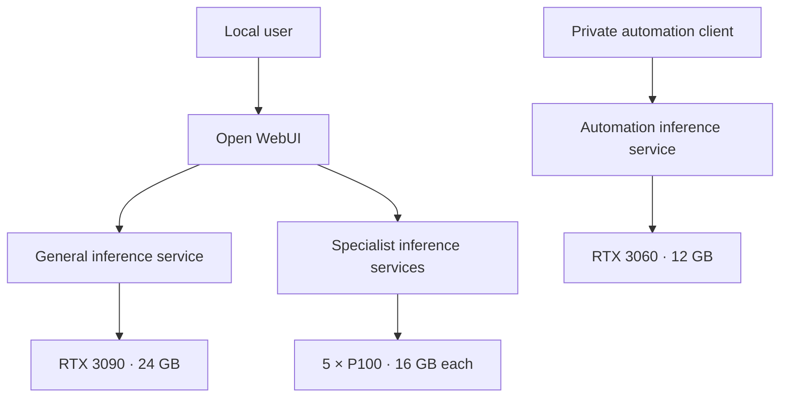

# Heterogeneous Local AI Lab

A self-hosted inference lab built around seven NVIDIA GPUs: five Tesla P100s, one RTX 3090, and one RTX 3060. This repository documents workload placement, local model serving, deployment boundaries, and repeatable evaluation on mixed-generation hardware.

**Author:** JT Corbin  
**Status:** Portfolio documentation reconstructed from project records on November 12, 2026. The server is offline for maintenance. This is a sanitized reference repository, not an export of the live server or a claim that the included examples have been deployed there.

## Hardware

| Component | Recorded configuration |
|---|---|
| Motherboard | Supermicro X9DRX+-F |
| CPU | 2 × Intel Xeon E5-2680 v2; 20 cores / 40 threads total |
| Memory | 128 GB ECC DDR3 |
| Primary inference GPU | RTX 3090, 24 GB |
| Automation GPU | RTX 3060, 12 GB |
| Specialist GPU pool | 5 × Tesla P100, 16 GB each |
| Storage | 1 TB NVMe, PCIe adapter |
| Operating system | Ubuntu Server; exact current release pending maintenance verification |

The current owner-reported GPU inventory totals **116 GB of distributed VRAM**. This is not a unified memory pool. Older records describe four P100s; the fifth card and its service assignment need an inventory check when the machine returns. No claim is made that a single model can use all memory efficiently.

## What I built and operated

- Local language-model inference using Ollama, with Docker-hosted Open WebUI.
- Separate native Ollama service instances for a primary assistant and specialist workloads.
- A 3090-focused general inference workload, P100 specialist experimentation, and a 3060 security-assistant workload.
- Model experimentation across Qwen, Llama, Gemma, and DeepSeek families.
- Python/API automation, browser-agent experiments, and response/performance evaluation.

These are recorded project capabilities. Exact current service mappings, model tags, versions, and continuous GPU execution have not been revalidated. This repository does not contain the private automation implementation or present generated examples as historical production code.

## Architecture



This is a logical workload diagram, not a network map. It does not imply that all seven cards are active concurrently or that every P100 has a verified dedicated endpoint.

## Engineering decisions

| Decision | Reason and tradeoff |
|---|---|
| Separate inference services | Explicit workload ownership and independent model lifecycles; requires resource coordination |
| Prefer one GPU per fitting workload | Avoid unnecessary cross-card transfers; limits usable model memory per instance |
| Use P100s selectively | Reuse existing accelerator capacity; requires Pascal-compatible binaries and cooling |
| Keep inference separate from tool execution | A model response is untrusted input; external actions need independent controls |
| Publish templates rather than live exports | Demonstrate design without leaking operational configuration |

Ollama may choose GPU placement differently from the logical roles. Verify actual offload and utilization rather than assuming a configured endpoint proves GPU execution.

## Explore the repository

- [Architecture and hardware constraints](docs/architecture.md)
- [Safe reference deployment](docs/deployment.md)
- [Security and publication boundaries](SECURITY.md)
- [Evidence and verification status](docs/evidence.md)
- [Benchmark methodology](benchmarks/README.md)
- [Official references](docs/references.md)

## Run the offline checks

Requires Python 3.10+; no third-party Python packages.

```bash
python -m unittest discover -s tests -v
python scripts/publication_check.py
```

The benchmark client is new sample tooling. It sends only a fixed synthetic prompt to a loopback Ollama endpoint and emits aggregate timing/count metadata, not generated text. See its README before running.

## Next verification steps

After maintenance: verify GPU inventory privately, record runtime versions, validate service-to-GPU placement, collect repeatable benchmarks, and review a sanitized demo. No throughput numbers or unverified long-context claims are published as measured results.

## Scope

This project demonstrates local inference operations, heterogeneous GPU planning, API integration, evaluation design, and security-conscious technical documentation. It is an inference lab, not a claim of production availability or large-scale model training. Model weights and third-party software remain subject to their own licenses. No blanket license is assigned to this repository yet.
